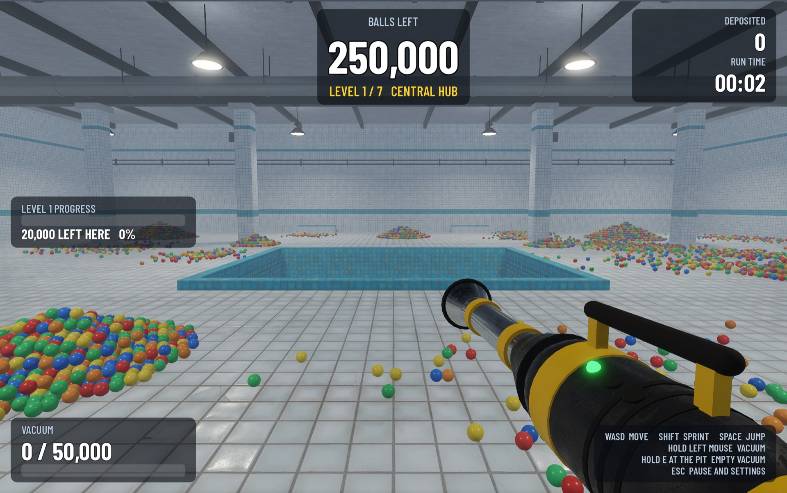

# KRX Ball Cleanup

First-person vacuum simulator in Godot 4. Seven connected levels hold 250,000 plastic balls. Vacuum them up
(the tank holds 50,000), carry them back to the pit in Level 1, empty the tank, repeat until nothing is left.

**Status: milestone 1. Level 1 (Central Hub, 20,000 balls) is playable. Levels 2 to 7 are not built.**
See [What is not built](#what-is-not-built).



## Run

Needs Godot 4.7 (developed on 4.7.2, Forward+ renderer).

```sh
# once, after a fresh clone, if assets/textures is empty
games/krx-ball-cleanup/tools/fetch_assets.sh      # downloads the CC0 texture sets and the font
games/krx-ball-cleanup/tools/import_assets.sh     # imports them compressed, with mipmaps

# play
/Applications/Godot.app/Contents/MacOS/Godot --path games/krx-ball-cleanup
```

Or open `games/krx-ball-cleanup/project.godot` in the Godot editor and press F5.

## Controls

| Input | Action |
| --- | --- |
| W A S D | Move (5 m/s) |
| Shift | Sprint (8 m/s) |
| Space | Jump |
| Mouse | Look |
| Hold left mouse | Vacuum |
| Hold E beside the pit | Empty the vacuum |
| Esc | Pause, settings, restart run, exit |

## What is playable

- Level 1: a 40 x 30 x 7 m tiled hall with pillars, twelve pendant lights, pipes and ducts, the collection pit
  in the middle and the locked door to Level 2.
- 20,000 balls in fifteen mounds plus loose patches. Each ball is one entry in a registry and is collected
  once. Piles slump as they are dug into.
- Vacuum: 1,200 balls a second at full power, 4.5 m reach, motor spin-up and spin-down, stops at exactly
  50,000 with a warning.
- Pit: hold E within reach to unload at 8,000 balls a second. Stops when E is released or the tank is empty.
- HUD: balls left in the run, level name, level progress, tank fill, deposited, run time, centre dot, prompts.
- Clearing Level 1 unlocks Level 2 (the door sign turns to UNLOCKED; there is nothing behind it yet).
- Pause menu with Restart Run (two presses) and working Graphics, Camera and Audio settings, saved to
  `user://settings.cfg`.

## How the balls work

250,000 rigid bodies would not run, so there are none. `scripts/managers/ball_manager.gd` keeps one height per
column of a hexagonal grid; a ball is (column, layer) and its position and colour follow from that. Balls only
leave from the top of a column, and a column more than one ball taller than a neighbour sheds a ball onto it,
which is what makes a dug pile slide. Only the top three layers of each column are drawn (deeper balls cannot
be seen), in one MultiMesh per 4 x 3.5 m chunk with three levels of sphere detail by distance.

Three things are simplified, on purpose:

- **The pit is a gauge.** The surface of balls in the pit rises with the share of the run deposited; it is not
  a pile of the individual balls you carried.
- **Balls in the air are a picture.** The count changes the moment a ball is collected or deposited. Up to 640
  balls are drawn in flight; when more are moving, a sample is shown.
- **Balls do not collide with the player.** You walk through piles.

## Check it

```sh
G=/Applications/Godot.app/Contents/MacOS/Godot

# script and resource errors
$G --headless --path games/krx-ball-cleanup --import

# plays Level 1 by itself: 56 checks, ends with "playtest ok" or "playtest fail"
$G --headless --fixed-fps 60 --path games/krx-ball-cleanup -- --playtest

# screenshots and frame times (needs a real window; add --native for full screen, --scale=0.5 for render scale)
$G --path games/krx-ball-cleanup -- --shots=/tmp/krx_shots --native --scale=0.5

# what each graphics option costs
$G --path games/krx-ball-cleanup -- --perf --native --scale=0.5
```

The playtest presses the real input actions, so it exercises the same code a player does: ball counts, walking
and sprint speed, jump height, wall, pillar, pit and door collisions, suction rate, the 50,000 cap, unloading,
every setting, pause, unlock and restart. Two shortcuts are taken and say so in the output: the tank is topped
up to 49,950 by the test instead of vacuuming 49,000 balls, and Level 1 is emptied in one call for the unlock check.

## Measured performance

One machine only: Apple M4 (base model), macOS, Metal, full screen on a 3420 x 2146 display, VSync off.
Nothing has been run on Windows.

| Case | Average | Slowest 1 % of frames |
| --- | --- | --- |
| High preset, 3D at 1710 x 1073 (render scale 50 %), spawn view | 67 fps | 61 fps |
| same, corner view with most balls on screen | 66 fps | 64 fps |
| same, vacuuming the largest pile | 81 fps | 70 fps |
| Low / Medium / Ultra presets, same render scale, spawn view | 175 / 139 / 65 fps | 136 / 119 / 63 fps |
| High preset, 3D at the full 3420 x 2146 (render scale 100 %), spawn view | 26 fps | 24 fps |
| same, vacuuming the largest pile | 31 fps | 28 fps |

The full-resolution rows are the reason the game starts with the render scale set so the 3D view is drawn at
about 1080 lines (100 % on a 1080p screen, 75 % on 1440p, 50 % on 4K); the slider in Settings raises it.
So: about 60 fps at High on this machine at 1080p-equivalent, with little to spare, and well under 60 at
4K-class resolutions. The cost is per pixel (lighting, reflections, anti-aliasing), not the balls: hiding
every ball saves about 2 ms a frame.

Other readings: filling Level 1 takes 57 ms; a physics tick of suction plus pile sliding takes 0.42 ms;
170 MB engine memory; 1.2 GB video memory at render scale 50 %, 1.6 GB at 100 %.

## What is not built

- Levels 2 to 7 and their 230,000 balls. They are counted in the totals but there is nowhere to collect them,
  so the run cannot be finished yet.
- TikTok LIVE interactions (F1 to F11), the reset countdown, the victory sequence, the monster.
- Save and load of a run. Only settings are saved.
- Music. The Music and Monster volume sliders, the TikTok settings page and Save Game are left out of the menu
  until the things they control exist.
- Windows export. Templates are installed; no build has been made or tested.
- Game Hub registration. The game is not in `games/registry.ts` and has no device link or gift actions.

Stand-ins, listed in [ASSET_CREDITS.md](ASSET_CREDITS.md): the vacuum is built in code from primitive shapes
(Blender was not available), and every sound is synthesised (no Freesound files).

Known rough edges: field of view is horizontal (90 by default); Godot prints a "7 RIDs of type Texture were
leaked" warning when the game quits.

## Layout

```
project.godot
autoload/      settings.gd (preferences), game_state.gd (the run's counts), sfx.gd (audio buses, sounds)
scenes/        main.tscn, player/, levels/level_1_hub.tscn, objects/collection_pit.tscn, ui/
scripts/
  main.gd                       wiring, pause, restart
  managers/ball_manager.gd      the ball registry, piles, suction, drawing
  gameplay/                     player.gd, vacuum.gd, ball_flyers.gd, level_1_hub.gd, level_kit.gd
  interactions/collection_pit.gd
  ui/                           hud.gd, centre_dot.gd, pause_menu.gd
  dev/playtest.gd               automatic test, screenshots, timings
assets/        textures/ (ambientCG), materials/, fonts/, audio/ and models/ (empty)
tools/         fetch_assets.sh, import_assets.sh
docs/          screenshots (ignored by Godot)
shaders/ resources/ export/     empty, reserved by the project layout
```
